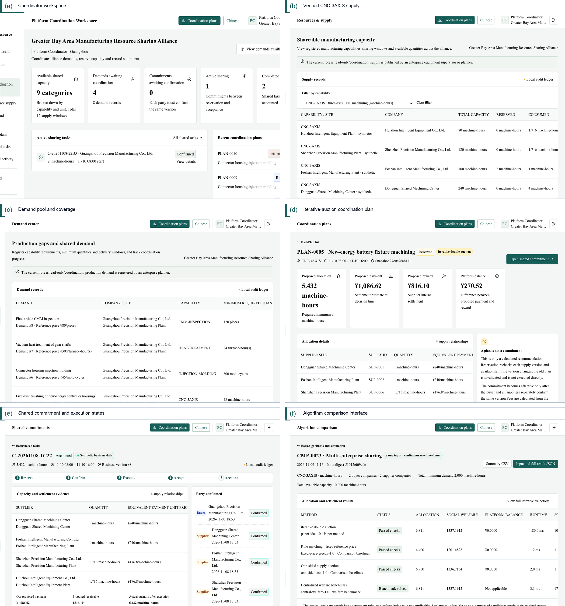
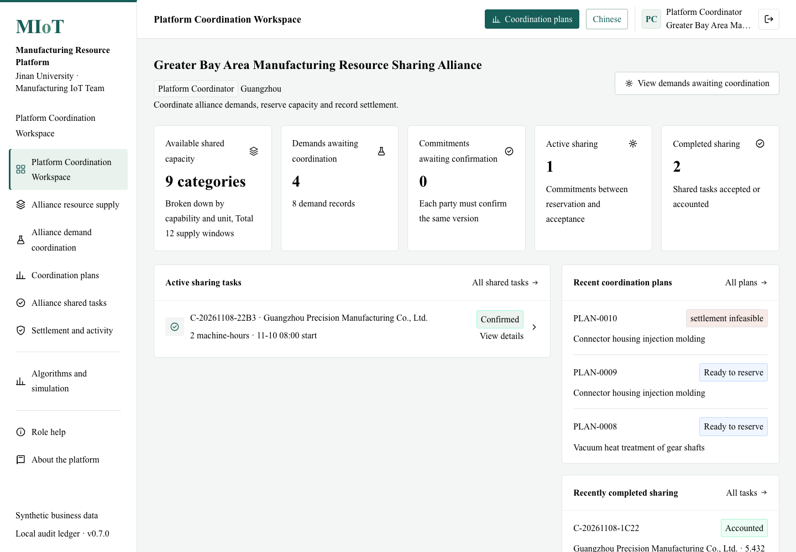
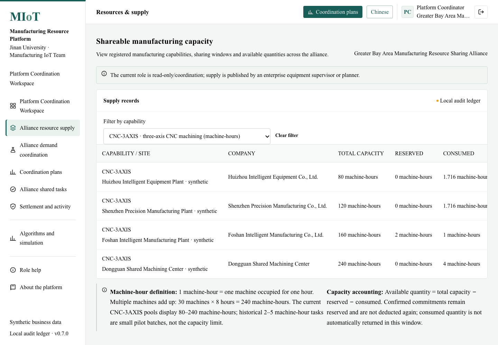
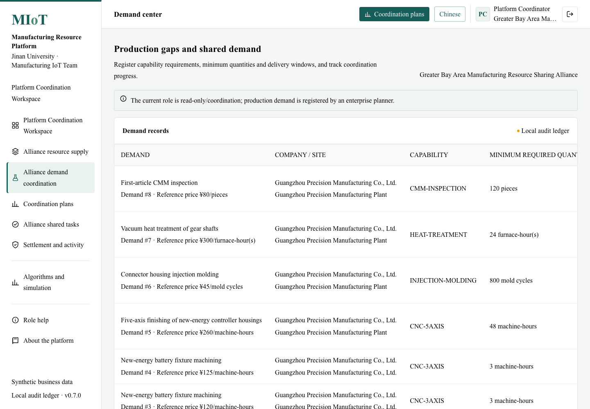
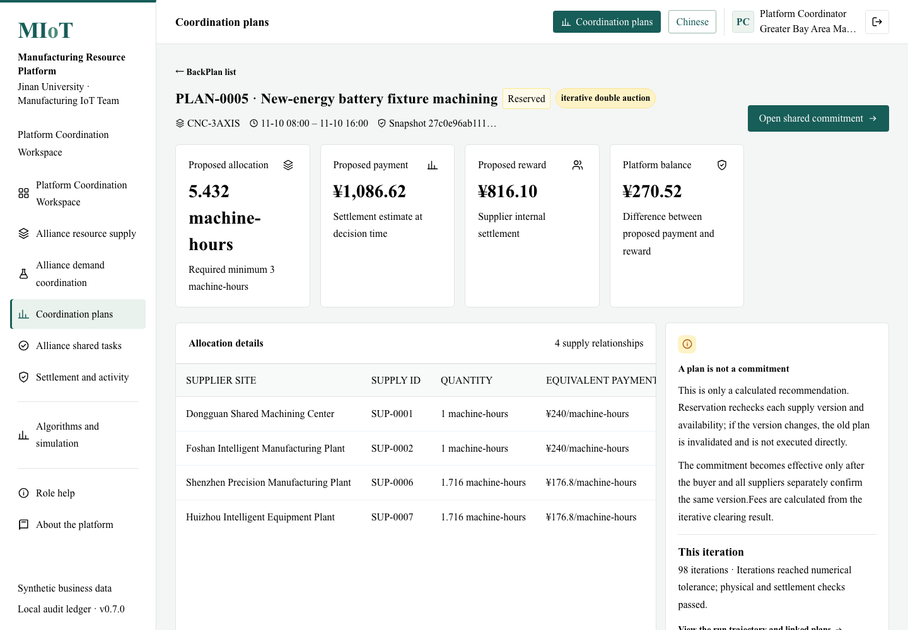
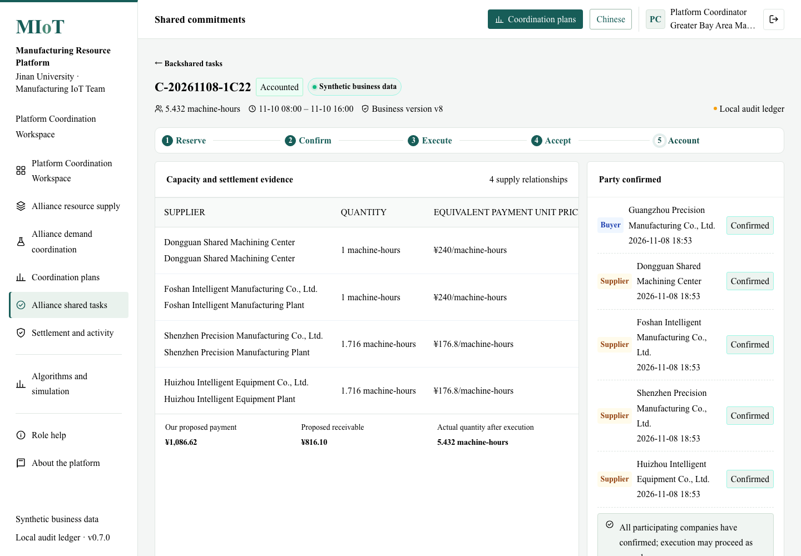
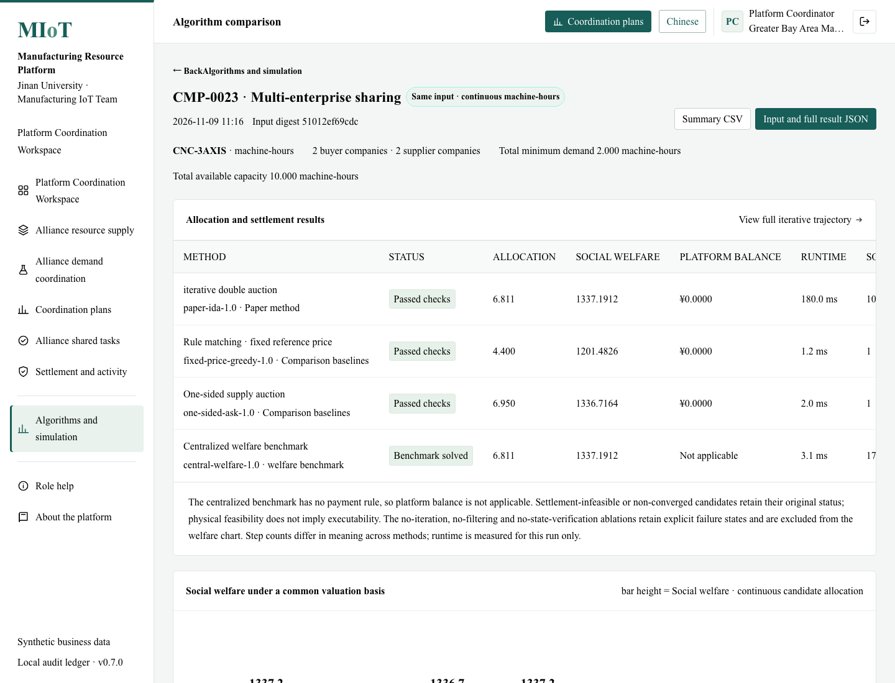
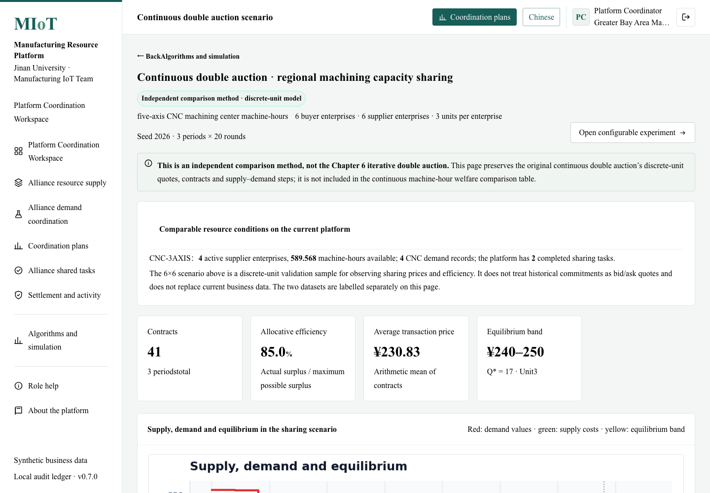

# GBA Multi-Factory Manufacturing Resource-Sharing Prototype

A research prototype of a cloud–edge collaborative manufacturing resource-sharing
platform for a hub-and-spoke manufacturing industrial park. The system turns
locally embedded manufacturing capacity into verified shareable resources,
constructs feasible sharing relationships, and coordinates eligible factories
through an iterative double auction.

This repository is a **clean distribution for GitHub and reviewers**. It contains
the web system, its supporting research engine, deployment files, and screenshots.
Older experimental notebooks, local data dumps, and unrelated development files
are intentionally excluded.

**Source repository:**  
https://github.com/huanliu111/Prototype-system-under-development-for-GBA-manufacturing-resource-sharing

**Live demonstration:**  
To be added after the Render deployment. See [DEPLOYMENT.md](DEPLOYMENT.md).
When the service is live, replace this line with the public URL.

## What the prototype demonstrates

- A coordinator workspace for verified supply, demand, active sharing tasks and plans.
- Capability-filtered resource pools (for example, `CNC-3AXIS`) with capacity accounting.
- A demand pool that records production gaps, minimum quantities, and delivery windows.
- Feasibility-aware coordination plans with allocation, payment, reward and broker balance.
- Shared commitments with reservation, confirmation, execution, acceptance and settlement states.
- A local hash-chained audit ledger for traceable records.
- An iterative double-auction comparison view for the paper method and baselines.
- A separate continuous double-auction validation view, `/cda-demo`, retained from the
  original open-source double-auction engine.

The records shipped with the demo are synthetic and are intended to exercise the
interface. They are **not** the controlled experimental results reported in the paper.

## Screenshots

### Paper figure: six-panel prototype walkthrough



### Coordinator workspace



### Verified machining resource supply



### Demand pool and production gaps



### Iterative double-auction coordination plan



### Shared commitment and execution states



### Algorithm comparison interface



### Original continuous double-auction validation



## Quick start

Python 3.10+ is recommended.

```bash
python3 -m venv .venv
source .venv/bin/activate
pip install -r requirements-web.txt
python run_web.py
```

Open <http://127.0.0.1:8000>.

Local demo accounts:

| Role | Username | Password |
|---|---|---|
| Platform coordinator | `coordinator` | `Demo2026!` |
| Enterprise planner | `demo` | `Demo2026!` |
| Consortium reviewer | `reviewer` | `Review2026!` |

For a public deployment, set the passwords through environment variables and do
not reuse the local demo values. The login page can also hide the account list.

## Public deployment

The application is a Flask service and cannot be hosted by GitHub Pages. Upload
the source to GitHub, then run it on Render, Railway, Fly.io, or a university
server. The included `render.yaml` is ready for a Render Blueprint.

A working public link therefore has two parts:

```text
Source code:  https://github.com/huanliu111/Prototype-system-under-development-for-GBA-manufacturing-resource-sharing
Live system:  https://<your-service>.onrender.com
```

See [DEPLOYMENT.md](DEPLOYMENT.md) for the complete procedure, environment
variables, and the SQLite persistence caveat.

## Repository layout

```text
webapp/                 Flask application, templates, CSS, static assets
  app.py                application factory and legacy experiment routes
  platform_routes.py    coordinator, resources, demands, plans, commitments,
                        traceability, algorithms, and CDA validation routes
  paper_algorithm.py    iterative double-auction implementation
  paper_coordination.py trial scenarios
  platform_store.py     platform data model and synthetic seed data
Algorithms/             original auction strategy code used by the CDA engine
Environment/            original spot-market environment
Institution/            original double-auction institution
Simulator/              original spot-market simulator
Trader/                 original trading strategies
screenshots/            screenshots used by this README and the paper
render.yaml             Render Blueprint
Dockerfile, Procfile    alternative deployment entry points
DEPLOYMENT.md           GitHub and hosting instructions
```

The `Algorithms/`, `Environment/`, `Institution/`, `Simulator/`, and `Trader/`
directories are retained because the independent `/cda-demo` validation page uses
the original double-auction engine. They are not required by the paper's iterative
auction implementation.

## Scope and limitations

- This is a research and demonstration prototype, not a production manufacturing
  execution system.
- Company names, capacities, prices, and records are synthetic and illustrative.
- The local audit ledger is a demonstration hash chain; it is not a deployed
  consortium blockchain or a Fabric network.
- The web prototype is separate from the MATLAB experiment engine used for the
  controlled results in the paper's Sections 7.2–7.5.
- The continuous double-auction page uses discrete resource units and is shown as
  an independent validation view; it is not mixed into the continuous machine-hour
  welfare table.

## Relation to the paper

The system supports the functional walkthrough in Section 7.1 and the six-panel
figure (`screenshots/fig12_prototype_system.png`). The screenshots demonstrate the
software workflow; the quantitative comparisons remain those generated by the
paper's controlled experiments.

## Acknowledgements and license

The continuous double-auction engine is derived from the open-source
[DoubleAuctionMarket](https://github.com/apayne19/DoubleAuctionMarket) project.
See [LICENSE](LICENSE) for the original license terms.
